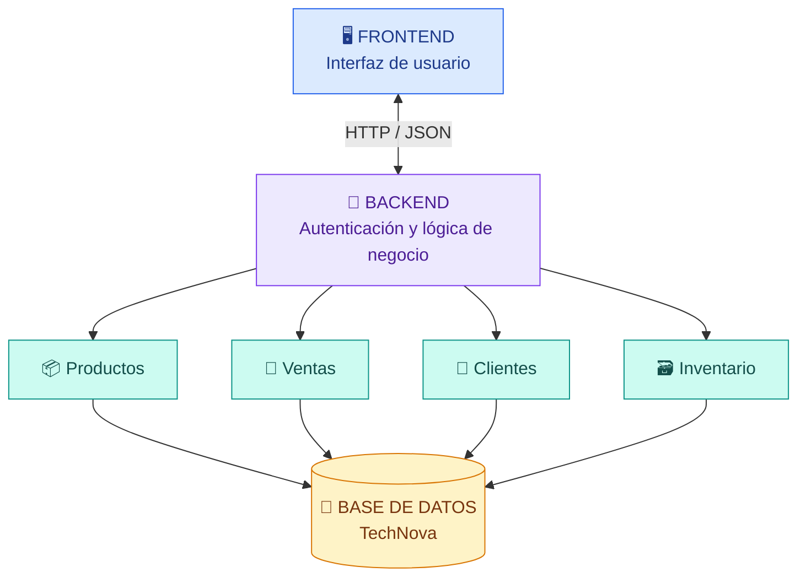

# 🖥️ TechNova POS

### Sistema de Punto de Ventas

**Una solución digital para gestionar productos, inventario, clientes y ventas.**

**Ingeniería de Software | Proyecto académico**

---

## 📖 Acerca del proyecto

**TechNova POS** es una propuesta de sistema digital para una tienda de productos tecnológicos. Su objetivo es facilitar la administración de productos, clientes, existencias y operaciones de venta mediante una solución organizada.

### 🎯 Objetivo

Diseñar un sistema de punto de ventas que permita registrar, consultar y administrar información comercial de manera eficiente, reduciendo los errores asociados a los procesos manuales.

### 🔎 Problema que busca resolver

La gestión manual o mediante registros separados puede ocasionar inconsistencias en el inventario, retrasos durante las ventas y dificultades para consultar información actualizada.

TechNova propone integrar estos procesos en una plataforma digital.

---

## ✨ Funcionalidades principales

| Módulo | Funcionalidad |
|---|---|
| 📦 **Productos** | Registrar, modificar, consultar y eliminar productos. |
| 🗃️ **Inventario** | Consultar y actualizar existencias. |
| 👥 **Clientes** | Registrar y consultar información de clientes. |
| 🛒 **Ventas** | Registrar ventas seleccionando productos y cantidades. |
| 📊 **Historial** | Consultar las ventas registradas. |

> **Nota:** Estas funcionalidades corresponden a los requisitos definidos. No representan módulos completamente implementados.

---

## 🏗️ Arquitectura del sistema

Se seleccionó una **arquitectura por capas**, separando las responsabilidades de presentación, lógica de negocio y almacenamiento de datos.

### 🖥️ Frontend

Será responsable de las pantallas, formularios y elementos visuales con los que interactuarán los usuarios.

### ⚙️ Backend

Procesará las solicitudes, aplicará las reglas de negocio, gestionará la autenticación y coordinará los módulos de productos, clientes, ventas e inventario.

### 💾 Capa de datos

Almacenará y permitirá consultar la información necesaria para las operaciones del sistema.

### 🔗 Comunicación frontend/backend

Se propone utilizar una **API REST** mediante solicitudes HTTP e intercambio de información en formato JSON.

El frontend enviaría las solicitudes al backend, que procesaría las operaciones y consultaría la base de datos cuando fuera necesario.

Esta comunicación está propuesta como parte del diseño y permanece pendiente de implementación.

---

## 🛠️ Herramientas utilizadas

| Herramienta | Uso |
|---|---|
| **GitHub** | Repositorio y control de versiones. |
| **GitHub Projects** | Organización y seguimiento de tareas. |
| **GitHub Issues** | Gestión de actividades e incidencias. |
| **Visual Paradigm Online** | Diagramas UML y arquitectura. |
| **Markdown** | Documentación técnica. |

---

## 📌 Estado actual del proyecto

**Etapa: documentación, modelado y planificación técnica.**

| Actividad | Estado |
|---|---|
| Requisitos funcionales | ✅ Definidos |
| Historias de usuario | ✅ Elaboradas |
| Diagramas UML | ✅ Elaborados |
| Arquitectura inicial | ✅ Definida |
| Gestión de tareas | ✅ Organizada |
| Implementación de módulos | 🔄 Pendiente o en planificación |
| Integración y pruebas | ⏳ Pendientes |

---

## 🚀 Próximos pasos

1. Continuar el diseño de la interfaz.
2. Desarrollar los módulos de productos e inventario.
3. Definir e implementar la base de datos.
4. Desarrollar los módulos de clientes y ventas.
5. Integrar los componentes.
6. Realizar pruebas funcionales.

---

## 📚 Documentación técnica

El repositorio reunirá las evidencias desarrolladas durante la asignatura:

- Requisitos funcionales e historias de usuario.
- Diagramas UML.
- Arquitectura inicial.
- Gestión y seguimiento del proyecto.
- Registro de cambios.
- Nota técnica de versión.

---

### 💙 TechNova POS

*Organización, tecnología y control para una mejor gestión comercial.*

**Versión documental propuesta: v0.1.0**

