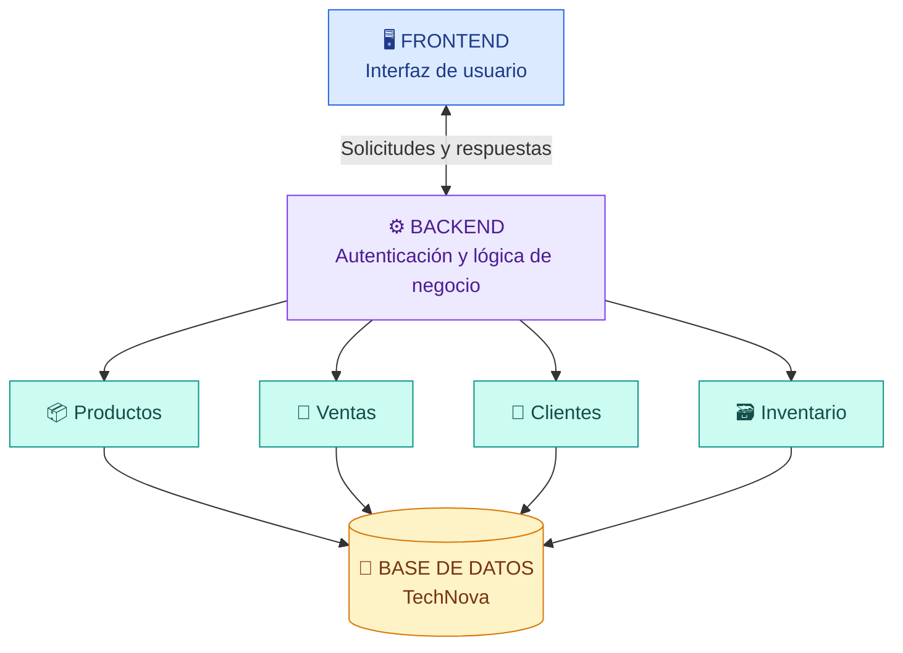

<div align="center">

# 🖥️ TechNova POS

### SISTEMA DE PUNTO DE VENTAS

**Gestión comercial, inventario y control de operaciones**

<sub>Una propuesta digital para una tienda de productos tecnológicos</sub>

<br><br>

<code>🛒 OPERACIONES COMERCIALES</code>
<code>📦 CONTROL DE INVENTARIO</code>
<code>👥 GESTIÓN DE CLIENTES</code>

<br><br>

<code>🏗️ ARQUITECTURA POR CAPAS</code>
<code>📋 REQUISITOS DEFINIDOS</code>
<code>🔖 VERSIÓN DOCUMENTAL 0.1.0</code>

<br><br>

**Ingeniería de Software | Proyecto académico**

</div>

---

## 📖 01. Presentación del proyecto

**TechNova POS** es una propuesta de sistema de punto de ventas orientada a mejorar la organización de las operaciones de una tienda de productos tecnológicos.

El proyecto busca integrar la gestión de productos, clientes, inventario y ventas en una misma solución digital, facilitando el registro y la consulta de información.

Su desarrollo se ha organizado por etapas, comenzando con la identificación de necesidades, definición de requisitos, elaboración de modelos UML, diseño de arquitectura y planificación técnica.

---

## 🎯 02. Objetivo del sistema

Diseñar un sistema digital de punto de ventas que permita administrar productos, controlar existencias, registrar clientes y gestionar operaciones comerciales de manera organizada, reduciendo los errores y dificultades asociados con los procesos manuales.

### 🔎 Problema identificado

La gestión manual o mediante registros separados puede ocasionar:

- Errores en el registro de productos.
- Diferencias entre las existencias reales y registradas.
- Retrasos durante las operaciones de venta.
- Dificultades para consultar el historial comercial.
- Información dispersa sobre clientes y productos.

TechNova propone centralizar estos procesos para facilitar la administración del negocio.

---

## 🧩 03. Funcionalidades principales

Las funcionalidades fueron definidas a partir de los requisitos del sistema.

| Código | Módulo | Funcionalidad |
|:---:|---|---|
| RF-01 | 📦 Productos | Registrar, modificar, consultar y eliminar productos. |
| RF-02 | 🗃️ Inventario | Consultar y actualizar las existencias. |
| RF-03 | 👥 Clientes | Registrar y consultar información de clientes. |
| RF-04 | 🛒 Ventas | Registrar ventas seleccionando productos y cantidades. |
| RF-05 | 📊 Historial | Consultar las ventas realizadas. |

> **Estado:** Estas funcionalidades están definidas como requisitos del proyecto. Su implementación completa permanece pendiente de verificación.

---

## 🏗️ 04. Arquitectura del sistema

Para TechNova se seleccionó una **arquitectura por capas**, separando la presentación, la lógica de negocio y el almacenamiento de datos.

Esta decisión busca facilitar la organización de los componentes, su mantenimiento y el desarrollo progresivo del sistema.

### Diagrama general de arquitectura



### 🖥️ Frontend: capa de presentación

El frontend será la parte visual del sistema y permitirá la interacción de los usuarios con las diferentes funcionalidades.

**Responsabilidades previstas:**

- Presentar la interfaz principal.
- Mostrar productos y existencias.
- Facilitar el registro de clientes.
- Permitir seleccionar productos para una venta.
- Mostrar mensajes y resultados de las operaciones.

### ⚙️ Backend: lógica de negocio

El backend se encargará de recibir y procesar las solicitudes realizadas desde la interfaz.

**Responsabilidades previstas:**

- Gestionar autenticación y autorización.
- Procesar operaciones relacionadas con productos.
- Controlar la información del inventario.
- Gestionar clientes y ventas.
- Aplicar las reglas de negocio.
- Coordinar las consultas y actualizaciones de datos.

### 💾 Capa de datos

Será responsable del almacenamiento y recuperación de la información del sistema.

Incluirá los datos necesarios para administrar productos, clientes, ventas y existencias.

### 🔗 Comunicación frontend y backend

Se propone utilizar una **API REST** para la comunicación entre frontend y backend, mediante solicitudes HTTP e intercambio de datos en formato JSON.

El funcionamiento previsto será:

1. El usuario realiza una operación desde el frontend.
2. El frontend envía la solicitud al backend.
3. El backend valida la información y aplica las reglas de negocio.
4. Cuando corresponde, consulta o actualiza la base de datos.
5. El backend devuelve una respuesta al frontend.
6. La interfaz presenta el resultado al usuario.

> **Nota técnica:** La API REST y el intercambio mediante JSON forman parte de la propuesta de diseño. No se presentan como funcionalidades ya implementadas.

---

## 🛠️ 05. Herramientas utilizadas

| Herramienta | Aplicación en el proyecto |
|---|---|
| GitHub | Repositorio y control de versiones. |
| GitHub Projects | Organización, prioridades y seguimiento de tareas. |
| GitHub Issues | Registro y seguimiento de actividades técnicas. |
| Visual Paradigm Online | Elaboración de diagramas UML y arquitectura. |
| Markdown | Organización de la documentación del repositorio. |

---

## 📂 06. Organización de la documentación

La estructura documental propuesta para el repositorio es:

```text
TechNova-POS/
│
├── README.md
├── CHANGELOG.md
│
└── docs/
    ├── requisitos/
    ├── uml/
    ├── arquitectura/
    ├── gestion-proyecto/
    └── evidencias/
```

**Descripción de las carpetas:**

- `requisitos/`: requisitos funcionales e historias de usuario.
- `uml/`: diagramas de casos de uso, clases, secuencia, actividades y comunicación.
- `arquitectura/`: diagramas y decisiones arquitectónicas.
- `gestion-proyecto/`: planificación, seguimiento y riesgos.
- `evidencias/`: capturas y documentación de apoyo.

Esta estructura se completará progresivamente con los archivos elaborados durante la asignatura.

---

## 📌 07. Estado actual del proyecto

TechNova se encuentra en una etapa de **documentación, diseño y planificación técnica**.

| Actividad | Estado |
|---|---|
| Definición de requisitos | ✅ Realizada |
| Historias de usuario | ✅ Elaboradas |
| Modelado UML | ✅ Elaborado |
| Arquitectura inicial | ✅ Definida |
| Organización en GitHub Projects | ✅ Realizada |
| Documentación del repositorio | 🔄 En consolidación |
| Desarrollo de módulos | ⏳ Pendiente de completar |
| Integración del sistema | ⏳ Pendiente |
| Pruebas funcionales | ⏳ Pendientes |

El estado descrito corresponde al avance documental y de planificación del proyecto. No implica que el sistema se encuentre listo para su uso comercial.

---

## 🗂️ 08. Gestión y seguimiento

El avance de TechNova se organiza mediante GitHub Projects, utilizando las siguientes columnas:

**Backlog → Por hacer → En progreso → En revisión → Finalizado**

Las tareas técnicas se clasifican según:

- Tipo de actividad.
- Prioridad.
- Rol responsable.
- Fecha estimada.
- Estado de avance.

GitHub Issues complementa esta organización al permitir documentar y dar seguimiento individual a las tareas, mejoras e incidencias del proyecto.

---

## 📝 09. Registro de cambios

Los principales avances documentados durante la asignatura son:

| N.º | Avance o ajuste |
|:---:|---|
| 01 | Definición de requisitos funcionales e historias de usuario. |
| 02 | Elaboración de diagramas UML del sistema. |
| 03 | Selección de arquitectura por capas. |
| 04 | Organización y seguimiento de tareas en GitHub Projects. |
| 05 | Consolidación de documentación técnica para la versión inicial. |

El registro detallado de cambios se organizará en el archivo `CHANGELOG.md`.

---

## 🔖 10. Control de versión

### Versión documental propuesta: v0.1.0

**Tipo:** Versión inicial de documentación y diseño.

**Contenido previsto:**

- Requisitos funcionales.
- Historias de usuario.
- Modelos UML.
- Arquitectura inicial.
- Planificación y seguimiento técnico.
- Documentación principal del proyecto.

**Limitaciones actuales:**

- Los módulos funcionales no se consideran completamente implementados.
- La integración frontend/backend permanece pendiente.
- La base de datos requiere implementación y validación.
- Las pruebas funcionales y de integración están pendientes.

La versión se identificará formalmente mediante una etiqueta de Git cuando la documentación correspondiente esté consolidada en el repositorio.

---

## 🚀 11. Próximos pasos

1. Completar la documentación técnica del repositorio.
2. Revisar los Issues pendientes y sus prioridades.
3. Continuar el diseño de la interfaz principal.
4. Desarrollar los módulos de productos e inventario.
5. Implementar la estructura de la base de datos.
6. Desarrollar las funcionalidades de clientes y ventas.
7. Integrar los componentes.
8. Realizar pruebas funcionales y de integración.

---

## 📚 12. Evidencias del proyecto

Las evidencias técnicas se organizan a partir de tres herramientas principales:

**GitHub Projects:** seguimiento del avance y organización de tareas.

**GitHub Issues:** documentación y control de tareas e incidencias.

**Visual Paradigm Online:** diagramas UML y representación de la arquitectura.

Estas evidencias permiten mantener continuidad entre las diferentes etapas del proyecto.

---
## Implementación previa del sistema

Como parte de los antecedentes del proyecto TechNova POS, se incorporó una aplicación desarrollada anteriormente en la asignatura Desarrollo de Proyecto con Software Libre.

Esta aplicación fue construida utilizando Ubuntu Server, Apache, PHP, Laravel, MariaDB y Bootstrap, e implementa un módulo CRUD para la gestión de productos tecnológicos.

El código fuente se encuentra organizado en la carpeta `implementacion-previa/technova-laravel/`.

Esta implementación sirve como base práctica para los requisitos de gestión de productos y control de inventario. Sin embargo, su adaptación al sistema TechNova POS, así como los módulos de clientes, ventas e historial de ventas, forman parte del trabajo pendiente.

### Repositorios relacionados

- [TechNova-POS – Ingeniería de Software I](https://github.com/wlngtnmendez1999/TechNova-POS)

<div align="center">

### 💙 TechNova POS

**Diseñar · Organizar · Desarrollar · Validar**

*Tecnología aplicada a una gestión comercial más organizada.*

<sub>Ingeniería de Software | Versión documental propuesta 0.1.0</sub>

</div>
